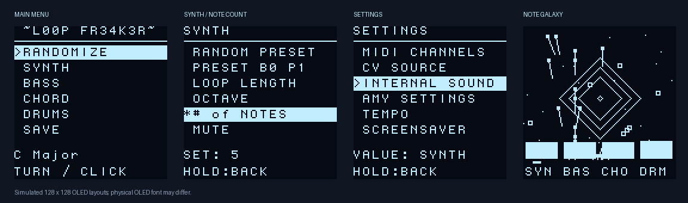

# AMYboard MIDI looper

`sketch.py` now starts the OLED sequencer after the existing four-second
hold-button recovery window. It returns to the firmware rather than entering
the old blocking menu loop, so the serial REPL remains available.

The musical generators are ported from
[racompton/midi-generator](https://github.com/racompton/midi-generator/blob/main/midi_looper.py),
source blob `0fa04f2d690f1e444bb839adbad824cc09a43158`. The port retains the
scales, weighted loop lengths, chord voicing/reharmonization, bass passing notes,
drum probabilities, and two-note synth edits. Desktop `mido`, terminal input,
threads, and sleeps are replaced with AMYboard interfaces.



[Animated screensaver preview](assets/looper-screensaver.gif). These previews run
the actual menu/animation code with a simulated display and approximate font.
[BAM! effect preview](assets/looper-bam.png).
[LOAD match preview](assets/looper-load.png).
[DRUM ROLL menu preview](assets/looper-drum-roll.png).

## Install

Use current AMYboard firmware with `amyboard.encoder()`, `amyboard.cv_out()`,
and `sequencer.TulipSequence`. The API references used for this port are
[amyboard.py](https://github.com/shorepine/tulipcc/blob/main/tulip/shared/amyboard-py/amyboard.py),
and [sequencer.py](https://github.com/shorepine/tulipcc/blob/main/tulip/shared/py/sequencer.py).

Back up `/user/current/` before replacing files. Copy these files together to
`/user/current/`, copying `sketch.py` last:

```text
loop_random.py          MicroPython random helpers
loop_patterns.py        original musical generators
loop_engine.py          note, channel, mute and CV logic
loop_sets.py            persistent named loop sets
loop_preset_preferences.py  persistent channel-specific MIDI preset choices
loop_settings.py        persistent device-wide clock, ghost, bank settings
loop_ui.py              encoder gestures, menus, note galaxy
loop_hardware.py        MIDI and CV output
sequencer_app.py        firmware callbacks and application lifetime
sketch.py               boot entry point and recovery window
```

Older `menu.py`, `loop_amy_settings.py`, and `perf_config.json` files may remain
on the board for rollback, but the looper no longer imports them or plays AMY
internal audio. No `mido`, desktop Python packages or additional OLED driver
files are needed on the board.
The display uses AMYboard's SSD1327/SH1107 support; the encoder uses the unified
accessory API. MIDI OUT uses the board's configured TRS A/B pin at 31,250 baud.

After copying, reset the board. Hold the encoder button during the recovery
window to skip the sequencer. From the REPL you can stop or restart it:

```python
import sequencer_app
sequencer_app.stop()
sequencer_app.start()
```

For code updates, reset after uploading all modules, or call
`amyboard.restart_sketch()` from the REPL. To return to the previous application, change the last two lines in
`sketch.py` back to `import menu` and `menu.main()`.

## Controls

Rotate to select a row; scrolling stops at the first and last rows. Click to run an action or enter value editing; an asterisk
marks editing. Rotate to change the value, then click to finish. Hold for 650 ms
to go up one menu level, including when editing. While editing a MIDI channel,
occupied channels display `IN USE` but can be scrolled past; clicking one is
rejected to prevent program changes and note-offs interfering with that track.
Clicks take effect
as soon as the button is released; a double-click acts as two ordinary clicks.

```text
RANDOMIZE
PERFORM
  MUTE / UNMUTE for SYNTH / BASS / CHORD / DRUMS / KICK
  VARIATION / DRUM ROLL / TEMPO / NEXT BAR
LOCKS
  KEY / SYNTH / BASS / CHORD / DRUMS
  P SYNTH / P BASS / P CHORD / P DRUMS
SYNTH
  RANDOMIZE
  RANDOM NOTES
  RANDOM PRESET
  PRESET B1 P1  (shows current external bank/program)
    SELECT PRESET / PREFER PRESET / DELETE PRESET / NORMAL PRESET
  LOOP LENGTH
  VARIATION      change up to two existing notes
  STYLE          MELODIC / MINIMAL / BUSY
  DENSITY        10–90% (generation setting)
  DIRECTION      FORWARD / REVERSE / PING PONG / RANDOM
  OCTAVE
  # of NOTES
  MUTE / UNMUTE
BASS / CHORD
  RANDOMIZE
  RANDOM NOTES
  RANDOM PRESET
  PRESET B1 P1  (BASS) / PRESET P1  (CHORD)
    SELECT PRESET / PREFER PRESET / DELETE PRESET / NORMAL PRESET
  LOOP LENGTH
  STYLE / DENSITY (BASS: GROOVE / ROOTS / WALKING;
                   CHORD: HOLD / STACCATO / HIT)
  DIRECTION      FORWARD / REVERSE / PING PONG / RANDOM
  OCTAVE
  # of NOTES
  CHORD SIZE     (CHORD only, 1–5 voices; default 4)
  MUTE / UNMUTE
DRUMS
  RANDOMIZE
  RANDOM NOTES
  RANDOM PRESET
  PRESET B1 P1
    SELECT PRESET / PREFER PRESET / DELETE PRESET / NORMAL PRESET
  LOOP LENGTH
  GENRE          HOUSE / TECHNO / BREAKS / ELECTRO / DRUM'N'BASS
  STYLE / DENSITY (GROOVE / SPARSE / BUSY)
  GHOST NOTES    0–100% in 5% steps; default 35%
  GHOST VELOCITY 1–127; default 70, varied by up to ±10
  GHOST ON MUTES OFF / ON; default OFF
  DRUM ROLL
    TRIGGER NOW
    AUTO EVERY    OFF or 32–1024 beats in steps of 32; default 128
    LENGTH        4–32 beats; default 8
  MUTE / UNMUTE
  DRUM PARTS
    KICK / SNARE / TOMS / RIMSHOT / CLAP / HATS / CYMBALS
      RANDOM NOTES
      MUTE / UNMUTE
SAVE
LOAD
  [SAVED SET NAMES]
  DELETE...
    [SAVED SET NAMES]
      CANCEL / DELETE SET
SETTINGS
  MIDI CHANNELS
    SYNTH / BASS / CHORD / DRUMS
  PRESET BANKS
    SYNTH / BASS / CHORD / DRUMS
      BANK COUNT       1–16
      BANK N PRESETS   1–128 per bank
  CLOCK SOURCE     INTERNAL / MIDI IN / CV1 IN / CV2 IN
  CV OUTPUT FROM   OFF / SYNTH / BASS / CHORD / DRUMS
  TEMPO
  SWING            50% / 58% / 67% / 75%; default 50% (straight)
  MIX             ON / OFF (default ON)
  AUTO PLAY       OFF / ON (default OFF)
  SCREENSAVER    OFF / ON
  VERSION         installed looper release (read-only)
PLAY / STOP
```

SYNTH favors chord tones on strong steps, moves mostly to nearby notes, and
repeats an eight-step motif with occasional changed endings. STYLE and DENSITY
controls shape the next generated pattern and are stored as
device settings. BASS adds root anchors on available kick beats; SYNTH sometimes
leaves space at chord changes. During AUTO PLAY, generated synth notes favor
pitch classes shared by the outgoing and incoming keys.

CHORD STYLE also affects the current loop: HOLD sustains chord voicings,
STACCATO repeats the full chord on sixteenth-note steps with a half-step gate,
and HIT plays one short chord at each new voicing. Saved sets and device settings
using the old ARP style load as STACCATO. DRUMS STYLE varies the pattern within the selected genre and does not
change the genre or tempo. DENSITY controls each instrument independently.

DRUMS → DRUM PARTS → HATS → RANDOM NOTES chooses a recognizable closed/open
four- or eight-step hat motif inspired by the selected genre and repeats it
across the fixed note bank. One quarter of generated hat patterns instead use
closed hats on each quarter-note beat, with four distinct velocities repeating
every bar. Open and closed hats never share a step.
It preserves other drum parts and the hats' mute state. A very short loop is
guaranteed at least one hat hit; widening it reveals the same generated tail.

PERFORM provides track and kick mutes, a synth VARIATION, a drum roll, and TEMPO
in one page. Each mute row says MUTE or UNMUTE according to its current state.
NEXT BAR queues global RANDOMIZE, mutes, VARIATION, and DRUM ROLL for the next 16-step bar;
OFF executes them immediately. The queued synth variation is prepared ahead of
time, and discarded if the synth pattern changes before the bar. Tempo edits
remain immediate. Instrument-specific randomization actions remain immediate.
Global RANDOMIZE prepares the new tracks in short background slices before
switching them, keeping generation out of the note callback.

LOCKS protects KEY, individual tracks, or individual presets from RANDOMIZE
and AUTO PLAY generation. A locked melodic track also holds the key so its notes
are not carried into a different scale. Direct edits and LOAD remain available;
locks are session controls and reset on reboot. AUTO PLAY's minimum audible
instrument and drum-unmute rules still apply. Lock changes wait until a running
mix or AUTO PLAY handoff is complete.

GHOST NOTES controls extra live drum hits: on the eighth-note offbeat, each
eligible step has the configured chance of adding one snare, rimshot, clap,
or tom. Hats are excluded so the repeating hat motif remains intact. GHOST VELOCITY sets the center of the random velocity range; each
hit varies by up to 10 in either direction, bounded by 1–127. GHOST ON MUTES
allows ghosts to use individually muted parts when ON; OFF respects their mutes.
Muting the whole DRUMS track always suppresses its ghosts, and notes already
sounding on that step are skipped.
At 0%, these live extras stop; quiet notes already embedded in a generated drum
pattern remain. Ghost settings, swing, clock source, and preset-bank layout are
stored in `/user/looper_settings.json` and survive reboot. This file is separate
from saved sets and is not included in releases.

SWING delays every other sixteenth note across all four tracks. The values
show the first note's share of each two-step pair: 50% is straight, and 75%
is the strongest swing. The four levels follow the existing 24-PPQ clock
resolution; outgoing MIDI clock stays straight. External devices need their own
swing setting if their sequencers should swing too.

INTERNAL uses the looper tempo. MIDI IN follows incoming MIDI realtime F8
clock and FA/FC Start/Stop (24 pulses per beat). CV1 IN or CV2 IN treats each
rising pulse above 1.5 V as one quarter-note beat and schedules 16th-note
steps between pulses. The input must fall below 0.8 V to rearm. CV playback
waits for the first pulse; if the clock stops for two beats, the looper stops
and waits for another rising pulse. External clock tempo takes precedence over
the TEMPO and genre targets while clocked. MIDI and CV clock paths continue to
send clock and notes to the physical TRS MIDI OUT jack.

PRESET BANKS configures how many MIDI banks and programs per bank each track
can select from. Custom ranges constrain both SELECT PRESET and random preset
choice; an active preset outside a reduced range is moved into the valid range.
CHORD's factory default remains the Minilogue's continuous P1–P200 mapping.
When CHORD uses custom ranges, it sends ordinary bank-select MSB plus program
change instead.

Main RANDOMIZE matches Enter: it chooses a new scale, regenerates all four
patterns, randomizes all four presets, randomizes SYNTH/BASS/CHORD mutes and
each drum-part mute, and leaves the whole DRUMS mute unchanged outside AUTO
PLAY. As in the
original, random mutes can produce a quiet pattern; unmute tracks/parts as desired.
It also shows a 640 ms static BAM! starburst. The OLED refreshes once for the
picture and once to restore the menu.
Main RANDOMIZE unmutes DRUMS and at least two melodic instruments, even if
that requires unmuting a locked track; locks still preserve its pattern.
Main RANDOMIZE also restarts the automatic drum-roll and 64-beat kick-breakdown
countdowns and chooses a new 2–16 beat breakdown duration. DRUMS RANDOMIZE and
RANDOM NOTES also choose a new breakdown duration and restart its countdown.
The new key is limited to its current Camelot position, one position clockwise
or counterclockwise on the same major/minor ring, or the relative major/minor
at the same number. For example, C Major (8B) can move to C Major, F Major,
G Major, or A Minor. The 24 conventional major/minor keys are available. Legacy
nonstandard scales are matched to nearby conventional keys by pitch overlap;
when no close match exists, RANDOMIZE keeps that scale and changes the patterns.
This follows [Mixed In Key's basic Camelot moves](https://mixedinkey.com/workflows/how-to-use-the-camelot-wheel/).
Instrument RANDOM NOTES keeps the scale and preset. RANDOM PRESET keeps notes
and mute state. Each melodic note-count detent adds or removes one occupied
step, from one to the current loop length. Existing notes at other steps stay
as they were; OCTAVE changes by three semitones per detent (one quarter octave),
and displays the total pitch shift in semitones.
The first item inside each instrument, RANDOMIZE, changes that instrument's
notes, preset, style, density, and loop length, always unmutes it, and shows the BAM! starburst. DRUMS
also randomizes its individual part mutes but always unmutes the kick.
MIDI channel and octave stay as configured. The main RANDOMIZE and AUTO PLAY
also choose styles, densities, and loop lengths for unlocked tracks. Drum genre
and genre tempo stay unchanged by randomization. When any melodic
track's notes are randomized, there is a one-in-three chance its note
durations will vary; each held note ends by the next note in that track.
CHORD SIZE changes the number of simultaneous pitches in each sounding chord
immediately, and the choice is retained through note randomization and saved
sets. Old saved sets without this field load with the four-note default.
Each LOOP LENGTH detent halves or doubles the loop. SYNTH, BASS and DRUMS
range from 1 to 64 sixteenth notes; CHORD ranges from 16 to 256, with HOLD
below 16. HOLD sustains the current chord until the track is muted, stopped,
replaced, or taken out of HOLD. It is independent of CHORD STYLE.
Shortening hides the tail, and lengthening reveals the same notes and hits;
new chord steps are generated only when first needed.
The hidden tail is saved with the set. Older sets generate any missing tail
once on their first extension. Turn DIRECTION to preview and click to apply.
DIRECTION changes melodic playback order:
FORWARD is the default, REVERSE reads backward, PING PONG bounces between
the ends, and RANDOM plays every step once per cycle in a shuffled order.
Turn GENRE to preview a style, then click to confirm.
Confirming regenerates the drum loop and eases the global tempo over 64 beats
toward HOUSE 124, TECHNO 130, BREAKS 135, ELECTRO 140, or DRUM'N'BASS 174 BPM.
The tempo remains editable via SETTINGS → TEMPO afterward.

The menu title is `~L00P FR34K3R~`. The main screen shows the abbreviated key
at left, genre letter near the middle, and right-aligned BPM, for example
`C MAJ  H     124`; the number follows tempo glides. SAVE writes the
complete current set to
`/user/sets/` under a unique uppercase adjective/noun name prefixed by the
genre letter (H, T, B, E, or D), for example `H FUCKING DUCK`. Earlier sets
without a prefix remain loadable. A set includes all
four patterns, external presets, mutes, channels, CV routing, tempo, and genre.
Unsaved edits still reset on boot. LOAD groups names by genre in menu order
(HOUSE, TECHNO, BREAKS, ELECTRO, DRUM'N'BASS); within each group, older saves
appear first and new saves at the bottom. `/user/sets/.save_order.json` keeps
that order across restarts. Sets from before this index existed use filesystem
timestamps when available, then directory order as a fallback.

With SETTINGS → MIX ON (the default), selecting a set cues its BASS for the
next beat. The loaded SYNTH takes over 32 beats later, CHORD another 32 beats
later, and DRUMS at the next automatic drum roll. The new drum pattern becomes
audible after that roll; setting DRUM ROLL → AUTO EVERY to OFF instead makes the
next 64-beat kick break the drum handoff. The OLED shows `MIXING IN BASS`,
`MIXING IN SYNTH`, `MIXING IN CHORD`, `MIXING IN DRUMS`, then `MIX COMPLETE!`.
Old and new tracks retain independent loop phases during the mix. MIDI channels
from the saved set are applied together at the final handoff so the interim
tracks cannot collide on a channel. Loaded key, tempo, genre, CV routing, and
drum settings also become active at that final handoff.

With MIX OFF, LOAD waits until all current loops complete together, then starts
the saved loops together. When playback is stopped, LOAD always applies
immediately. LOAD → DELETE... lists names, then requires a separate
DELETE SET choice; deleting a queued set also cancels that pending load.
Set storage runs in short background steps between MIDI clocks, so the menu
may briefly show SAVING or LOADING while playback continues.

AUTO PLAY is off by default. When enabled, it prepares four fresh randomized
instrument loops and presets in small slices between MIDI clock pulses. The
incoming key is chosen from the current key's Camelot-compatible neighbors.
The drum roll runs every 128 beats in this mode. For the 32 beats before each
roll, snare, clap, and two other randomly selected drum parts are temporarily
silenced; the stored pattern and part mutes remain intact. A new transition
begins 64 beats after a roll, with at least 128 beats between a completed
transition and the next one. The four instruments switch in random order,
32 beats apart; DRUMS switches at its turn. DRUMS stays unmuted, and at least
two of SYNTH, BASS, and CHORD remain unmuted throughout. Incoming melodic mute
states are otherwise randomized. The previous drum-roll interval is restored
when AUTO PLAY is turned off.
The main screen shows the current key and incoming key separated by `>` during
the transition, then returns to the new current key when all four tracks have
switched. The bottom status line shows beats until the next instrument switch
and the instrument name while AUTO PLAY is on. With AUTO PLAY off it shows
beats until the next drum roll and `*` before each audible instrument initial,
for example `R128 *S  B *C *D`. Turning AUTO PLAY off lets an active transition
finish; manual LOAD takes priority and resets the AUTO PLAY wait.
In LOAD, matching sets have bright lines above and below their names, and the
selected row says `KEY MATCH` or `OTHER KEY`. Matching uses the playing key and
the same Camelot neighbors/relative major-minor rule as RANDOMIZE; the marks
update if the playing key changes while LOAD is open. Other-key sets remain
loadable.

Each instrument's PRESET row shows its current external MIDI preset. SYNTH,
BASS, and DRUMS show bank and program, both starting at 1; CHORD shows a single
number. SELECT PRESET lets the knob scroll through valid choices, sending the
selected preset on that MIDI channel.
CHORD targets the original Korg minilogue's 200 programs. Its menu shows one
continuous P1–P200 range. The looper stores these positions across two internal
groups for compatibility with existing saved sets and preset preferences, then
sends MIDI Bank Select MSB 0, LSB 0 or 1, and Program Change 0–99. This reaches
programs 101–200 without changing their saved-set identities. The minilogue's
MIDI Rx CC and MIDI Rx Prog Chg settings must be On.
Click again to finish editing. PREFER PRESET gives that exact
bank/program 16 times the normal chance during randomization. DELETE PRESET
removes it from future random choices; it does not stop the sound currently
playing. NORMAL PRESET clears either choice. Preferences apply to that
instrument on its current MIDI channel, so changing CHORD from channel 6 to 5
uses channel 5's choices. They persist separately from saved sets in
`/user/preset_preferences.a.json` and `.b.json`; a saved set does not change
these global preferences when loaded. Older saved SYNTH presets outside the
new bank ranges are clamped into their bank's valid range when loaded.

Each boot runs the same Camelot-compatible global RANDOMIZE action before MIDI
Start, so the first autoplayed set has fresh notes, presets, and mutes. The
first OLED frame is drawn before transport starts. Playback begins at 124 BPM.
The main-menu footer places an abbreviated key at left, the genre initial near
the center, and BPM against the right edge. House starts at 124 BPM; selecting
Techno targets 130 BPM and Breaks targets 135 BPM over the usual 64-beat glide.
On Adafruit seesaw encoders, the looper splits position and button I²C reads
across short callbacks while retaining the chip's register-settling time. This
keeps encoder polling from consuming a whole MIDI-clock interval. A pending OLED
frame is retried when the next pulse is too close, so genre tempo changes do not
leave the menu waiting indefinitely for a redraw slot.
Defaults match the original channels as
displayed by MIDI equipment: SYNTH 4, BASS 3, CHORD 6, DRUMS 10. CHORD begins
muted; toms, rimshot, and cymbals begin muted. Muted loops continue advancing in
time with the other tracks. Chords are generated before bass so bass uses the
new progression rather than stale roots. Consecutive identical drum hits retrigger;
identical melodic/chord steps sustain, as in the desktop script.

For every genre, newly generated drum loops choose snare or clap with equal
probability for the backbeat on steps 5 and 13. The choice is held for the whole
loop and the chosen drum part is unmuted. An explicit later mute or manual
snare/clap part randomization remains available. These bar accents and the
quarter-note hat option keep their timing even in very short loops.

DRUMS adds occasional ghost hits at the configured velocity on eighth-note offbeats
during ordinary playback. A 2–16 beat kick break is chosen once for the set;
it ends at beat 64, repeats at the end of every 64-beat cycle with the same
duration, removes the kick and adds random other drum hits, then resumes the
saved loop. The duration is retained in saved sets. AUTO EVERY
triggers a 4–32 beat snare/tom roll (8 beats by default) with claps on roughly one quarter of its hits
when claps are unmuted, after the selected beat interval (128 by
default); OFF disables automatic rolls and TRIGGER NOW still plays a manual
one. The roll and kick break alter
playback only, so the original drum pattern returns afterward. Muted drum
parts remain muted during these events. A coincident roll takes priority over
the 64-beat break.

OLED updates are coalesced during fast knob turns. The UI skips work close to
the next MIDI clock pulse and, on firmware with background I2C, waits for the
previous panel transfer to finish before queuing another frame. This reduces
display traffic competing with playback. The sequencer callback still runs in
MicroPython, so hardware timing should be checked with the intended MIDI and
CV setup; Python display work cannot provide a hard real-time guarantee.

## Outputs

All four tracks transmit external MIDI. No internal AMY sound is played.
MIDI clock is 24 pulses per quarter note, with Start/Stop messages. Preset
randomization uses these bank/program ranges:

On physical AMYboard, the looper writes directly to the TRS MIDI UART. On the
tested firmware, `tulip.midi_out()` took about one second per message and
stalled both playback and the OLED. The direct UART kept 124 BPM playback in
time with the board sequencer during the on-board test. USB MIDI OUT is not
mirrored by this path; connect external instruments to the TRS MIDI OUT jack.
The TRS A/B type is read when the looper starts, so restart it after changing
`amyboard.set_midi_type()`.

| Track | OLED bank | OLED programs |
|---|---:|---:|
| SYNTH | B1 | 1–26 |
| SYNTH | B2 | 1–51 |
| SYNTH | B3 | 1–40 |
| SYNTH | B4 | 1–17 |
| BASS | B1 | 1–101 |
| CHORD | B1–B2 | 1–128 |
| DRUMS | B1 | 1–128 |

The MIDI wire uses zero-based bank/program values, one less than the OLED shows.
A drum bank change gets the
original 50 ms settling interval without blocking the other tracks. External
drum attacks during that brief interval are skipped. Program/bank availability
still depends on the receiving instrument.

CV OUTPUT FROM defaults to SYNTH. CV1 is pitch
at 1 V/octave, MIDI note 60 (C4) = 0 V. CV2 is a 5 V gate, 0 V when off. Chords
use their lowest sounding note. Percussion gates release halfway through a
sixteenth note to give repeated hits a low interval. Muting, rerouting, stopping,
or replacing an active loop releases its old notes/gate. Pitch holds during rests.

## Screensaver and timing

SCREENSAVER defaults to OFF. When enabled, after 60 seconds without a knob turn
or button interaction, the OLED becomes a note galaxy: note-powered comet trails, percussion shockwaves, dancing instrument
meters, sustained-note stars and a moving step marker. Particles are bounded in
memory and visual effects never consume the music generator's random stream.
Music continues. The first interaction only wakes the display; it restores the
exact page, cursor and editing state. A waking
button press is suppressed through release so it cannot accidentally randomize.

AMY's sequencer clock drives playback independently of UI polling. The regular
menu redraws only when it changes; static BAM displays one frame and the
optional screensaver is capped at 2 FPS to reduce contention with playback.
SAVE, LOAD, and DELETE run in small clock-slack steps; saved-set keys are cached
so LOAD highlighting never reads files while drawing. Callback errors stop
playback, lower the gate and leave an error on the OLED and the REPL available.
Processor overload that does not raise an API error requires hardware measurement.

## Validation

Run `python3 -m unittest discover -s tests -v`. Tests cover the musical generators
across the legacy scales and all 24 Camelot keys, held notes, repeated drums, mute/channel/preset transitions,
CV pitch/gates, MIDI clock, encoder debounce and
long press, screensaver wake consumption, preset range selection, and
bounded animation state. Tests use board API doubles, not physical hardware.

Before relying on the port for performance, verify on your board:

1. Boot/recovery, encoder direction, OLED orientation and every submenu.
2. External MIDI clock/note timing during RANDOMIZE and static BAM display.
3. C4 → 0 V, C5 → +1 V, note-off → 0 V gate, and lowest-note chord routing.
4. Manual preset selection across SYNTH bank boundaries and program changes.
5. Long press, wake-by-turn, wake-by-short/long-press, and stop with notes held.

Firmware compatibility has been checked on a connected AMYboard, but DAC
calibration, audio quality and processor headroom still require physical
measurement.

### Musical phrases and TB-3 slides

SYNTH and BASS choose original 16-step rhythmic motifs inspired by the selected
drum genre and fit pitches to the active scale, with chord tones emphasized on
strong beats. One quarter of phrases receive a one-step rhythmic variation.
Generated SYNTH phrases can include slide transitions; their positions are saved
with the set and survive loop resizing. On a slide, the looper sends TB-3 CC 102
and overlaps the incoming and outgoing MIDI notes. The TB-3 needs firmware 1.10
or later for CC 102; confirm the sound and slide response on the instrument.

New drum loops have independent one-in-four chances for a quieter kick and
another quiet drum hit on step 14, 15, or 16 of an available bar. Loops shorter
than 14 steps have no such step. Kicks otherwise play only on quarter-note beats,
including when a short loop or an older saved set repeats.
Ordinary generated drum hits use velocities 90–127; kick hits on steps 1, 5,
9 and 13 use 127, the MIDI maximum. The quieter fill, configurable ghost notes,
breaks and rolls retain their own dynamics.
